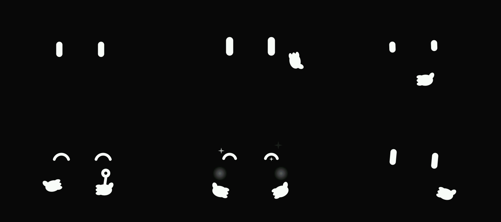

# Pocket Companion

一个放在桌上的语音小伙伴：说话唤醒或按键，它用一张方形 Nomi 风格的脸回应你。设备直接调用 OpenAI 兼容的 API，中间不需要任何服务器。



从左到右、从上到下依次是：待机、聆听、思考、说话、开心、疑惑。这张图是固件里的 `face.c` 在电脑上直接渲染出来的。

## 架构

```text
┌──────────────────────── 设备（ESP32-S3） ────────────────────────┐
│ 小智固件：唤醒词 / 回声消除 / VAD / 配网 / 屏幕 / 触摸            │
│                                                                  │
│ 录音 ──▶ DirectApiProtocol ──HTTPS──▶ /audio/transcriptions      │
│                │            ──HTTPS──▶ /chat/completions         │
│                │            ──HTTPS──▶ /audio/speech（Ogg Opus） │
│                ▼                                                 │
│ NomiDisplay（表情跟随设备状态和 LLM 情绪）  ◀── 播放              │
└──────────────────────────────────────────────────────────────────┘
```

- 固件底座是 [小智 xiaozhi-esp32](https://github.com/78/xiaozhi-esp32) v2.5.2，以 git subtree 放在 `firmware/`。
- 我们加的代码：
  - 板子适配、表情和界面：`firmware/main/boards/spotpear/spotpear-esp32s3-max35/`（`nomi_ui.c` 和模拟器共用）
  - 直连 API 协议和网页设置页：`firmware/main/protocols/direct_api_*`
  - 启动流程里的开关：`firmware/main/application.cc` 中的 `CONFIG_DIRECT_API`
- 打开 `DIRECT_API`（这块板默认打开）后，设备不连小智服务器，不激活，也不会被官方 OTA 覆盖。

## 硬件

SpotPear ESP32-S3 3.5 寸 AI 板（ESP32-S3R8，8MB PSRAM，480×320 ST7796S，ES8311 + NS4150B，GT911 触摸）。引脚和注意事项见 [docs/hardware.md](docs/hardware.md)。

## 使用

1. 烧录固件后，按小智的流程配网：手机连设备热点，在网页里填 Wi-Fi。
2. 设备连上网后，屏幕会显示设置页地址。用同一局域网的浏览器打开 `http://设备IP/`。
3. 填大模型的地址、Key、模型。语音识别和语音合成的地址、Key 留空时沿用大模型的，模型和音色按服务商填写。
4. 说唤醒词或按 BOOT 键开始对话。

所有接口都是 OpenAI 兼容格式。语音合成必须支持 `response_format: "opus"`。

## 编译

需要 ESP-IDF v6.1（小智 2.5 已不支持 5.x）。

```powershell
. C:\Espressif\tools\Microsoft.v6.1.PowerShell_profile.ps1
cd firmware
python scripts/build.py spotpear/spotpear-esp32s3-max35 --language zh-CN
idf.py -p COMx flash monitor
```

## 模拟器

### 设备模拟器（整机交互）

在浏览器里运行设备上同一份界面代码（`nomi_ui.c` + `face.c`，LVGL 9.5，小智的中文字体），鼠标当触摸：

- 点一下屏幕开始说话，再点一下结束；说话中点一下打断
- 长按屏幕打开设置菜单：音量、亮度、设置页地址、重新配网、关于
- 右侧圆钮或空格键是 BOOT 键

对话内容是模拟的，真正的 API 调用只在设备上跑。

```bash
# 先编译过一次固件（需要 managed_components 里的 LVGL 和小智字体）
cd tools/device-sim
pip install ziglang
python build.py
python -m http.server 8801    # 打开 http://127.0.0.1:8801/sim.html
```

### 表情模拟器

只看表情动画，不依赖固件编译：

```bash
cd tools/face-sim
python build.py               # --frames 另外渲染六个状态的截图到 out/
python -m http.server 8800    # 打开 http://127.0.0.1:8800/sim.html
```

## 同步小智上游

```bash
git subtree pull --prefix=firmware https://github.com/78/xiaozhi-esp32.git <tag> --squash
```

可能冲突的地方只有 `firmware/main/CMakeLists.txt`、`Kconfig.projbuild` 和 `application.cc` 里我们加的几段。

## 进度

- [x] 方形 Nomi 表情、板子适配、直连 API、网页设置页（ESP-IDF v6.1 编译通过）
- [x] 触摸交互：点击开始/结束对话，长按设置菜单（浏览器模拟器可试）
- [ ] 上机验证：屏幕方向和颜色、触摸坐标、音频
- [ ] 大模型工具调用：语音调音量/亮度、拍照识图
- [ ] 本地工具：红外 / 继电器

## 致谢

- 固件底座：[78/xiaozhi-esp32](https://github.com/78/xiaozhi-esp32)（MIT）
- 本仓库最初由 [FoloToy/ai-passport](https://github.com/FoloToy/ai-passport) 复制而来，原有代码已全部替换。

许可证见 [LICENSE](LICENSE)。
